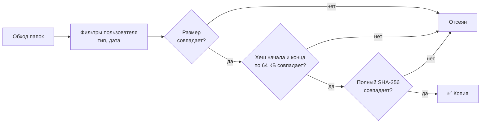

<p align="center">
  
</p>

<h1 align="center">FindTheSame</h1>

<p align="center">
  Настольное приложение для поиска файлов, полностью совпадающих по содержимому с заданным файлом-эталоном.
</p>

<p align="center">
  
  
  
</p>

---

## О программе

Выбираете файл-эталон и папки для поиска — FindTheSame находит все копии этого файла, даже если они переименованы, имеют другое расширение или лежат глубоко во вложенных папках. Сравнение идёт **по содержимому**, а не по имени: два файла считаются копиями, только если совпадают байт в байт.

## Возможности

- **Точный поиск копий** по хешу SHA-256 с каскадной фильтрацией — большая часть файлов отсеивается без чтения содержимого.
- **Несколько папок поиска** — вложенные папки распознаются автоматически, чтобы одни и те же файлы не проверялись дважды.
- **Фильтры**: по типам файлов (`pdf, docx, doc`) и по дате изменения.
- **Перетаскивание из Finder / Проводника**: файл становится эталоном, папка добавляется в список поиска.
- **Работа в фоновом потоке**: окно не зависает, отображается число просмотренных файлов, поиск можно остановить в любой момент.
- **Действия с результатами**: открыть файл, показать в Finder / Проводнике, скопировать путь, переместить в Корзину (можно несколько файлов сразу).
- **Аккуратная обработка ошибок**: недоступные папки и файлы пропускаются, поиск при этом не прерывается.

## Как это работает

Хешировать каждый файл на диске — долго. Поэтому кандидаты проходят через каскад проверок от дешёвых к дорогим, и до полного чтения доходят лишь единицы:



1. **Обход папок** — рекурсивный, через `os.scandir`. Символические ссылки не разыменовываются (защита от зацикливания), скрытые файлы и папки пропускаются.
2. **Размер** — у копий он обязан совпадать, а узнать его можно без чтения файла. На этом шаге отсеивается подавляющее большинство кандидатов.
3. **Частичный хеш** — SHA-256 от первых и последних 64 КБ. Быстро отбрасывает файлы одного размера, но с разным содержимым.
4. **Полный хеш** — SHA-256 всего файла, читаемого блоками по 1 МБ, поэтому даже очень большие файлы не загружаются в память целиком. Полный хеш эталона вычисляется лениво — только когда появился первый кандидат, дошедший до этого шага.

## Установка и запуск

Требуется Python 3.14 (на более ранних версиях 3.x тоже, скорее всего, заработает, но не проверялось).

```bash
git clone https://github.com/elizarkarapetov/FindTheSame.git
cd FindTheSame

python3 -m venv .venv
source .venv/bin/activate        # Windows: .venv\Scripts\activate
pip install -r requirements.txt

python main.py
```

## Сборка приложения

Используется [PyInstaller](https://pyinstaller.org). Сборка возможна только под ту ОС, на которой она запускается.

### macOS (`.app`)

```bash
pip install pyinstaller pillow
pyinstaller FindTheSame.spec
```

Готовое приложение — `dist/FindTheSame.app`.

### Windows (`.exe`)

На Windows-машине:

```powershell
pip install pyinstaller pillow
pyinstaller --windowed --name FindTheSame --icon assets/icon_windows.png main.py
```

Либо без Windows — через GitHub Actions (workflow `.github/workflows/build-windows.yml`):

```bash
gh workflow run build-windows.yml
gh run watch
gh run download -n FindTheSame-windows -D dist-windows
```

## Структура проекта

```
FindTheSame/
├── main.py                 # точка входа
├── core/                   # логика поиска, не зависит от Qt
│   ├── file_info.py        # класс FileInfo — путь, размер, время изменения
│   ├── scanner.py          # рекурсивный обход папок с фильтрами (генератор)
│   ├── hasher.py           # полный и частичный SHA-256
│   └── search.py           # каскадный поиск копий эталона
├── gui/                    # интерфейс на PySide6
│   ├── main_window.py      # главное окно
│   └── worker.py           # фоновый поток поиска (QThread)
├── assets/                 # иконки приложения
├── FindTheSame.spec        # настройки сборки PyInstaller (macOS)
└── requirements.txt
```

Пакет `core` ничего не знает об интерфейсе: остановка поиска и счётчик прогресса передаются в него обычными функциями обратного вызова. Благодаря этому логику поиска можно использовать и тестировать отдельно от GUI.

## Ограничения

- Ищутся только **точные** копии. Файлы, отличающиеся хотя бы одним байтом (например, тот же документ, пересохранённый в другой программе), копиями не считаются.
- Запрос на остановку проверяется между файлами: если в этот момент хешируется очень большой файл, поиск остановится после его дочитывания.
- На macOS при первом поиске в «Документах», «Загрузках» или на «Рабочем столе» система запросит разрешение на доступ. Если отказать, эти папки будут пропущены.
- Приложение не подписано сертификатом разработчика, поэтому при первом запуске macOS и Windows покажут предупреждение.
- Размеры отображаются в двоичных единицах (1 КБ = 1024 Б), поэтому могут немного отличаться от Finder, который делит на 1000.

## О проекте

«Программа для поиска файлов с одинаковым содержимым с заданным файлом».

Разрешено использование в некоммерческих целях по согласованию с автором, а также с указанием автора.

Автор — Елизар Карапетов

Контакт для связи: elizarkarapetov750@gmail.com